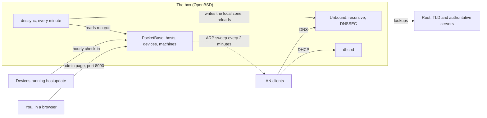

# HomeSubnetDns


**Your own DNS and DHCP for a home network, on one small OpenBSD box.** It runs
a validating resolver that answers from the root servers itself, keeps local
names you edit in a web page, lets devices keep their own names current, and
shows a live list of every machine on the LAN.

Consumer routers rarely let you choose the DNS server they hand out. They
send every lookup to the ISP, and they know nothing about the names of your
own machines. HomeSubnetDns moves DNS and DHCP onto a box you control, keeps
all of its configuration in git, and deploys it with one idempotent installer.

## Features

- **A private, validating resolver.** Unbound resolves from the root servers
  itself, with no upstream forwarder, and does DNSSEC validation, caching,
  QNAME minimisation, and DNS-rebinding protection.
- **Local names, edited in a web page.** Host records live in
  [PocketBase](https://pocketbase.io). Edit them in its admin page, and
  they're served, forward and reverse, within a minute. A bad record is
  skipped and logged, and a failed sync leaves DNS working.
- **Devices name themselves.** The [`hostupdate`](hostupdate/README.md)
  client (POSIX sh, for OpenBSD and Linux) checks in hourly and at boot, so
  `laptop.home.arpa` follows the laptop's address: dynamic DNS for the LAN.
  Its installer also points the device's resolver at the box (systemd-resolved,
  NetworkManager, dhcpcd, unwind, and more), and undoes that cleanly.
- **Aliases and dotted names.** Give one machine several names (`app`,
  `test.app`, `runtask.test.app`), and choose which one a reverse lookup of
  its address returns.
- **Who's online.** Every two minutes, PocketBase sweeps the LAN with ARP,
  which every machine has to answer, firewall or not. The `online_machines`
  view lists the address, MAC, reverse name and DHCP hostname of every
  machine that's on, wired or Wi-Fi.
- **DHCP that hands out the box.** OpenBSD's dhcpd replaces the router's DHCP
  server, so every client uses the box for DNS.
- **One idempotent installer.**
  - `scripts/install-box --check` shows a diff of everything it would change,
    and changes nothing.
  - Without `--check`, it changes only what differs.
  - It also sets up a fresh box and restores one from a backup.
  - It can run on the box itself, from a single offline bundle.
- **Nothing about your network is hard-coded.** The only settings are the
  domain and the box's address. The installer reads the netmask and gateway
  from the box's interface, and works out the subnet, DHCP pool and reverse
  zone from them. Moving the box, or a router that renumbers the LAN, means
  changing one setting and running the installer again.
- **Least privilege.** Each part runs as its own unprivileged user. The sync
  job's account can only read. pf opens DNS and the admin page to the LAN
  only.

## How it works



| Part | What it does |
|---|---|
| **Unbound** | Answers the LAN. It resolves everything itself, and serves the local zone from a static file and from the file dnssync writes |
| **PocketBase** | Holds host records, aliases and device accounts. It also serves the device check-in endpoint, and runs the LAN scan that fills `machines` and `online_machines` |
| **dnssync** | A Perl script, using only modules that come with OpenBSD. Every minute it renders the records into an Unbound include file, checks it, and reloads Unbound without flushing its cache |
| **dhcpd** | Hands out addresses from the upper half of the subnet, with the router as gateway and the box as DNS server |
| **hostupdate** | Runs on each device, not the box. A tiny client that reports the device's name; the server records the address the request came from |

## Requirements

- **The box:** OpenBSD 8.0 on amd64. A small VM is plenty (it runs on
  2 vCPUs and 1 GB of RAM). It needs a user in group `wheel` that can use
  `doas`, and an address on the LAN outside the router's DHCP pool.
- **The router:** one whose DHCP server you can turn off. It stays the LAN's
  gateway.
- **A workstation** (Linux or WSL) with SSH key access to the box, `expect`,
  `dig`, and Go 1.26 or later. Go fetches the 1.27 toolchain the build needs.

## Quick start

Clone this repository, then:

```sh
cp site.conf.example site.conf          # set DOMAIN, ADDRESS and BOX_USER

# The box's doas password, in a private file outside the repo:
umask 077; printf '%s\n' '<doas password>' > ~/.config/homesubnetdns-doas.pass
export RDOAS_PASSFILE=~/.config/homesubnetdns-doas.pass

scripts/install-box --check             # what would change; touches nothing
scripts/install-box                     # run again until it says it's done
```

The installer builds and tests PocketBase, copies the files to the box, and
sets it up as root over SSH. It stops, and prints the exact command to run
next, wherever a person has to act:

1. **After moving the box to `ADDRESS`.** Run it again within three minutes
   to confirm the switch; otherwise the box goes back to its old settings.
2. **After a kernel patch.** Reboot the box, then run it again.
3. **Before starting DHCP.** Turn off the router's DHCP server, then run it
   with `--start-dhcpd`. Two DHCP servers must never run on one network.

On a new install, finish by creating the PocketBase admin account from the
setup link the installer tells you how to find.

**No workstation at hand?** `scripts/bundle` packs the installer, the build
and the configuration into one file of about 10 MB. Copy it to the box, then
run `tar xzf homesubnetdns-installer.tgz` and
`doas sh install-box/install.sh`.

[RUNBOOK.md §5](RUNBOOK.md#5-set-up-a-box-fresh-or-replacing-a-lost-one)
has the full walk-through, including restoring from a backup.

## Using it

| To | Do this |
|---|---|
| Add or change a host | Admin page (`http://pocketbase.<domain>:8090/_/`), collection **hosts**. Changes are served within a minute |
| Give a machine another name | Add a **hosts** record with `alias_of` set to the machine's record. Tick `takes_ptr` to make reverse lookups return the alias |
| Name a device that moves around | On the device: `sh hostupdate/install.sh --box <box address>`, then paste the name and password it prints into **devices** |
| See what's on the LAN | Collection **online_machines**, or `scripts/rdoas jobs/25-lan-scan.sh` |
| Change the configuration | Edit the repo, run `scripts/install-box --check`, then `scripts/install-box` |
| Back up, and restore | `scripts/backup` copies the data off the box; `scripts/install-box --restore <file>` brings it back on a new one |

## Repository layout

| Path | What's there |
|---|---|
| `site.conf.example` | The settings to copy into `site.conf`, which git ignores |
| `unbound/`, `pf/`, `dhcpd/`, `net/` | Config templates. The installer fills in their `@PLACEHOLDERS@` on the box |
| `pocketbase/` | Our PocketBase build in Go: validation, the check-in endpoint, the LAN scan, migrations and tests |
| `dnssync/` | The sync script and its crontab |
| `hostupdate/` | The device client, its installer and [its README](hostupdate/README.md) |
| `jobs/` | Scripts that run as root on the box. `23-install-box.sh` is the installer |
| `scripts/` | Workstation tools: `install-box`, `bundle`, `backup`, `build`, `stage`, `rdoas` |

## Documentation

- **[RUNBOOK.md](RUNBOOK.md)**: setup, deploying changes, day-to-day work,
  verification, gotchas, rollback and where each secret lives.
- **[PLAN.md](PLAN.md)**: the design, and the decisions behind it (D1–D44).
- **[hostupdate/README.md](hostupdate/README.md)**: installing and running
  the device client, and how it sets up each kind of resolver.

The examples throughout use `home.arpa`, the domain reserved for home
networks (RFC 8375), and the documentation addresses 192.0.2.0/24 (RFC 5737).

## Limitations

- **IPv4 only.** A router that hands out its own IPv6 DNS server lets
  clients bypass the box. The device installer and
  [RUNBOOK §8b](RUNBOOK.md#8b-sending-domain-lookups-to-the-box-on-each-device)
  deal with that, device by device.
- **A single resolver.** While the box is down, the LAN has no DNS, and new
  devices get no address.
- **Plain HTTP on the LAN.** The admin page and device check-ins aren't
  encrypted. Each device's password can only update that device's own name.
- **The LAN scan sees only the LAN itself.** VMs behind another machine's
  NAT, and guest Wi-Fi the router keeps apart, don't show.
- **Written and tested for OpenBSD 8.0 on amd64**, and for LANs from a /16 to a /29.
